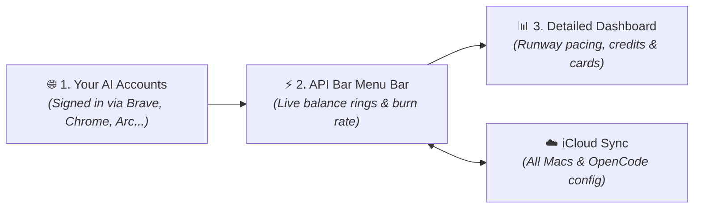

# ⚡️ API Bar

[](https://apple.com/macos)
[](https://swift.org)
[-purple)](https://developer.apple.com)
[](https://github.com/0xCosmosly/api-bar#privacy--security)
[](LICENSE)

> **A native macOS menu-bar companion to [CodexBar](https://github.com/steipete/CodexBar)** engineered to track active credits, quotas, and balances for AI providers it doesn't cover yet — right from your menu bar with zero API key hassle.

API Bar lives in your macOS menu bar alongside your daily developer tools, continuously pulling real-time credit balances, token burn rates, and subscription quotas from your signed-in browser sessions and custom endpoints. Never hit an unexpected rate limit or quota cutoff mid-prompt again.

---

## 📑 Table of Contents

- [Highlights](#-highlights)
- [Supported Providers](#-supported-providers)
- [How It Works](#-how-it-works)
- [Interface at a Glance](#-interface-at-a-glance)
- [Getting Started](#-getting-started)
- [Paper Design System](#-paper-design-system)
- [Architecture & Repository Map (Agent Guide)](#-architecture--repository-map-agent-guide)
- [Local Development & Testing](#-local-development--testing)
- [Privacy & Security Architecture](#-privacy--security-architecture)
- [Publishing a Release](#-publishing-a-release)
- [FAQ](#-faq)
- [Attribution & License](#-attribution--license)

---

## ✨ Highlights

- **Live Credit & Burn Rate Gauges**: Track remaining balances as dynamic percentage rings, microdollar increments, or currency values in your menu bar.
- **Burn Rate & Runway Pacing**: Real-time pacing estimates calculated from your active usage (e.g. `1.9M tokens per day - Runs out in 3 days`) so you never get surprised by an unexpected balance exhaustion.
- **OpenCode & Multi-Mac iCloud Sync (Optional)**: Seamlessly sync your monitored providers, baseline dollar targets, and optional OpenCode configurations (`opencode.json` models and providers) across all your Macs via iCloud with automatic safety backups.
- **Single or Multi-Icon Display**: Merge all providers into a single unified gauge with a rich drop-down dashboard, or pin individual provider gauges to your menu bar.
- **Zero API Key Hassle (Dominant Browser Session Import)**: Automatically detects your primary browser (Brave, Google Chrome, Arc, Microsoft Edge, Vivaldi, or Chromium) and imports authenticated sessions directly on-device. No hunting down admin API keys.
- **Dual Permission Model (Folder Access vs. Full Disk Access)**:
  - *Folder Access Only*: Instant, targeted permission scoped strictly to your selected browser folder without visiting macOS System Settings.
  - *Full Disk Access*: Automated, one-click access across all browser profiles and future browser updates.
- **On-Device Apple Intelligence Extractor (AFM)**: Add any custom or unsupported provider in seconds. Paste a cURL command or JSON payload, and on-device heuristics automatically extract the balance and configure the client.
- **Automatic 100% Baseline Ingestion**: Automatically detects payments, top-ups, and trial grants to calculate remaining percentage baseline.
- **Full Version History & Changelog Viewer**: Browse current and previous version releases, detailed feature breakdowns, and migration notes natively inside the app with rich markdown formatting and offline caching.
- **In-App Self-Updater**: Background update checks via GitHub Releases with native changelog presentation and one-click in-place installation.
- **100% Private, Local & Sandboxed**: Zero telemetry, zero third-party proxy servers. Cookies and authentication tokens remain encrypted in your local macOS Keychain.

---

## 🚀 Supported Providers

| Provider | What API Bar Tracks | Connection Source | Baseline Target |
| :--- | :--- | :--- | :--- |
| **Google Cloud / Vertex AI** | Active billing account credits & promotional grants | Dominant browser session (SAPISID auth) | Initial grant total |
| **Fireworks AI** | Inference balance & prepaid credits | Dominant browser session (`auth_token`) | Latest top-up |
| **Cerebras** | Fast inference platform credits & usage tier | Dominant browser session (`auth_token`) | Tier quota / top-up |
| **Google AI Studio** | Developer quota, token credits & project tiers | Dominant browser session (`__Secure-` auth) | Project allocation |
| **Refuseless** | Prepaid USD balance, deposit ledger & burn rate pacing | Dominant browser session | Total deposits sum |
| **Lutheos** | Private inference prepaid credit balance & runway pacing | Dominant browser session or Bearer key | Inferred top-up tier |
| **Venice AI** | Consumption currency balances (USD & DIEM) | Dominant browser session or Bearer key | Inferred baseline |
| **Crowbot** | Chat & API usage credits (microdollar precision) | Dominant browser session (`crowbot_session`) | Account quota |
| **OpenCode Sync (Optional)** | Bi-directional models & providers configuration sync | Apple iCloud Drive container | Automatic `.bak` safety |
| **Custom / Any AI API** | OpenRouter, Groq, Together, DeepSeek, local endpoints | cURL / JSON via on-device AFM extractor | Custom reference |

---

## 🧠 How It Works

API Bar seamlessly connects your day-to-day AI browser sessions to your macOS menu bar:



1. **No API Keys to Hunt Down**: API Bar detects your active browser on-device. It reads your authenticated session cookies locally and securely via macOS Keychain encryption—no need to generate or rotate administrative API keys.
2. **Real-Time Burn Rate & Runway**: Beyond raw balances, API Bar calculates your real-world consumption pace and displays how many days or hours remain before your credits exhaust.
3. **Optional OpenCode Syncing**: If you use OpenCode, you can optionally sync your models and provider definitions across your machines with automatic rollback backups. API keys and credentials are not synced and remain safely local to each machine.
4. **Completely Local & Private**: All balance checks happen directly between your Mac and the official AI provider endpoints. No middleman servers, no proxy servers, and zero telemetry.

---

## 🖥️ Native Interface & Experience

API Bar is built as a lightweight, native macOS menu bar utility tailored to developers:

- **Menu Bar Status Gauges**: Pin individual provider badges (e.g. `Refuseless 97%`, `Lutheos 67%`) or collapse them into a single merged gauge. Displays percentage rings, microdollar increments, or currency values.
- **Provider Popover Cards**: Click any gauge to inspect your remaining balance, exact reference baseline, brand-accented progress bar, daily token burn velocity, and estimated runway depletion timeline.
- **Settings & Session Management**: Connect your browser sessions in one click without generating API keys, configure optional iCloud sync for OpenCode configurations, and adjust baseline targets.
- **Built-in Offline Changelog**: Browse version release notes, architecture improvements, and new provider integrations natively from the menu bar or Settings header.

---

## 🛠️ Getting Started

### Prerequisites

- macOS 13.0 (Ventura), macOS 14.0 (Sonoma), macOS 15.0 (Sequoia), or later.
- Compatible with Apple Silicon (M1/M2/M3/M4) and Intel x86_64 architectures.

### Installation

1. Download the latest `APIBar-app.zip` from [GitHub Releases](https://github.com/0xCosmosly/api-bar/releases).
2. Unzip and drag `API Bar.app` to your `/Applications` folder.
3. Open `API Bar.app`. You will be guided through a quick 3-step setup:
   - **Step 1: Select Providers**: Pick the AI platforms you use.
   - **Step 2: Connect Browser**: Choose your browser profile and grant access (**Full Disk Access** or **Folder Access Only**). Click **Connect All**.
   - **Step 3: Menu Bar Preferences**: Choose whether to display a single merged icon or individual status gauges.

---

## 🎨 Paper Design System

API Bar is styled according to the **Paper Design System**, providing high contrast, accessible controls, and clean typographic hierarchy:

- **Monochrome Tile Badges**: Provider icons render as crisp black silhouettes centered on white rounded tiles with subtle borders.
- **High-Contrast Button States**: Disabled actions (such as connected buttons) maintain WCAG-compliant contrast (`#48484A` text on `#EBEBF0` background) without murky system dimming.
- **Unified Permission Hierarchy**: Both permission choices (**Grant Full Disk Access** and **Folder Access Only**) share the exact same button hierarchy, while destructive or stateful actions (**Relaunch API Bar**) are cleanly separated.
- **Hero Aggregate Overview**: When merged, API Bar presents an aggregate dollar total and percentage usage progress bar across all monitored endpoints.

---

## 🤖 Architecture & Repository Map (Agent Guide)

This section provides a structural guide for AI coding agents, autonomous planners, and contributors inspecting this repository:

```
API Bar/
├── Package.swift                    # Swift Package Manager manifest (macOS 13+)
├── build.command                    # Universal release build & packaging script
├── check.command                    # Sandboxed test suite runner (zero side effects)
├── Resources/
│   ├── Info.plist                   # App metadata & bundle configuration
│   ├── AppIcon.icns                 # High-resolution multi-size app icon
│   └── *-mask.png                   # 1x/2x/3x vector template silhouettes
├── Sources/
│   ├── Main.swift                   # Entry point (NSApplication bootstrap)
│   ├── App.swift                    # APIBarApp coordinator, status items & state
│   ├── Credentials.swift            # Browser detection, SQLite reader, AES decryptor
│   ├── SessionHTTP.swift            # Cookie-authenticated networking & SAPISID hashing
│   ├── GoogleProvider.swift         # Google Cloud & Vertex AI GraphQL credit client
│   ├── CrowbotProvider.swift        # Crowbot microdollar credit extractor
│   ├── AFMProviderExtractor.swift   # On-device heuristic balance parser
│   ├── Provider.swift               # BalanceProvider protocols & reading models
│   ├── ProviderTabsView.swift       # Menu bar drop-down tab bar and popover views
│   ├── MenuUI.swift                 # SwiftUI views (Settings, Onboarding, Paper badges)
│   ├── BrandMark.swift              # Custom vector graphics & icon renderers
│   ├── ICloudSync.swift             # CloudKit / NSUbiquitousKeyValueStore engine
│   ├── Changelog.swift              # Full version history & offline markdown changelog
│   └── AppUpdater.swift             # GitHub Releases in-app self-updater
└── Tests/
    ├── Checks.swift                 # Comprehensive unit & regression tests
    ├── UIInteractionChecks.swift    # Headless AppKit/SwiftUI component tests
    └── ConnectionDiagnostic.swift   # Live connection verification harness
```

### Key Source Responsibilities

| File | Primary Responsibility | Agent Implementation Note |
| :--- | :--- | :--- |
| `Credentials.swift` | Browser cookie discovery & decryption | Implements `SupportedBrowser` abstraction (Brave, Chrome, Arc, Edge). Queries OS Keychain for Safe Storage key. Uses `sqlite3` in read-only immutable mode. |
| `SessionHTTP.swift` | Network communication | Signs Google Cloud requests via SHA1 `SAPISIDHASH` with `X-Origin` header. Isolates cookie jars per provider. |
| `MenuUI.swift` | Interface & Paper tokens | Contains `PaperProviderBadge`, `PaperProminentButtonStyle`, `PaperWhiteButtonStyle`, `SettingsPane`, and `OnboardingView`. |
| `AFMProviderExtractor.swift` | Parsing arbitrary endpoints | Uses regex and JSON traversal heuristics to identify currency amounts, remaining tokens, and consumption fields from cURL inputs. |
| `ICloudSync.swift` | Cross-device state | Syncs encrypted session tokens, monitored provider sets, and baseline configurations via `NSUbiquitousKeyValueStore`. |
| `Changelog.swift` | Version history & changelog | Multi-version changelog viewer (current and previous releases), offline caching, and remote release synchronization. |

---

## 💻 Local Development & Testing

API Bar requires zero external dependencies and builds with standard Apple Command Line Tools.

### Running Sandboxed Tests

To execute the test suite without reading, modifying, or deleting real user data or live Keychain items:

```sh
./check.command
```

`check.command` executes:
- Isolated SQLite cookie ingestion tests using fixture databases.
- Cryptographic Keychain access policy validation (ensuring background operations reject interactive UI).
- On-device AFM extractor tests across multiple API formats.
- SwiftUI component rendering and interaction regression suites.

### Building & Installing

To compile a Universal binary (Apple Silicon + Intel) and install to `/Applications/API Bar.app`:

```sh
./build.command
```

This also packages an optimized release archive `APIBar-app.zip` in the root directory.

---

## 🔒 Privacy & Security Architecture

1. **No External Telemetry or Servers**: API Bar communicates strictly between your Mac and the official APIs of the providers you configure. There is no middleman backend, proxy server, or analytics pipeline.
2. **Local macOS Keychain Encryption**: Session credentials and keys are stored in the local macOS Keychain under service name `app.apibar.APIBar`.
3. **Non-Interactive Background Invariant**: Periodic background tasks set `LAContext.interactionNotAllowed = true` and `SecKeychainSetUserInteractionAllowed(false)` to guarantee API Bar never interrupts your workflow with Keychain authentication popups.
4. **Sandboxed Testing Boundary**: Verification scripts execute in throwaway temporary directories (`APIBAR_DATA_DIR`) ensuring developer workflows never touch production databases.

---

## 📦 Publishing a Release

API Bar includes an in-app updater that monitors GitHub Releases:

1. Update `CFBundleShortVersionString` in `Resources/Info.plist`.
2. Run `./build.command` to produce the application bundle and `APIBar-app.zip`.
3. Create a Git tag and push to `origin main`:
   ```sh
   git tag vX.Y.Z
   git push origin vX.Y.Z
   ```
4. Draft a release on GitHub matching tag `vX.Y.Z` and attach `APIBar-app.zip`.
5. Running instances will automatically discover the update, show the changelog, and allow users to install it in place.

> [!NOTE]
> When updating GitHub multiple times in a single day, stay on the same release version (e.g. `v0.5.0`), updating the existing release notes and uploading the refreshed `APIBar-app.zip` via `gh release upload <tag> APIBar-app.zip --clobber` to prevent version number churn.

---

## ❓ FAQ

**Q: Do I need to create an API key for every provider?**  
No. For natively supported providers (Vertex AI, Fireworks, Cerebras, Google AI Studio, Refuseless, Crowbot), API Bar reads your existing signed-in browser session. You can also provide manual Bearer tokens if preferred.

**Q: Which browsers are supported for automatic session import?**  
API Bar automatically detects your dominant browser and supports **Brave Browser**, **Google Chrome**, **Arc**, **Microsoft Edge**, **Vivaldi**, and **Chromium**.

**Q: What is the difference between Full Disk Access and Folder Access Only?**  
- **Full Disk Access**: Gives API Bar permission to read browser profile directories across future browser updates and path changes without further prompts.
- **Folder Access Only**: Lets you explicitly select your browser profile directory (e.g. `~/Library/Application Support/BraveSoftware/Brave-Browser`) via a standard macOS Open Panel, keeping permissions tightly scoped.

**Q: How does the automatic 100% baseline gauge work?**  
API Bar inspects your provider account's initial credit allocation or latest payment/deposit record. If you top up or receive a grant, API Bar automatically adjusts the 100% reference so your percentage gauge reflects actual remaining capacity.

**Q: Can I track unlisted AI APIs?**  
Yes. Open **Settings → Add Custom Provider**. Enter the provider's name or paste a cURL command from their documentation; on-device intelligence parses the endpoint structure, auth headers, and response balance fields automatically.

---

## 📄 Attribution & License

- **Design Inspiration**: Provider symbols and menu structures inspired by [CodexBar](https://github.com/steipete/CodexBar) (MIT).
- **License**: MIT License. See [LICENSE](LICENSE) or [THIRD_PARTY_NOTICES.md](THIRD_PARTY_NOTICES.md) for details.
- **Disclaimer**: Independent open-source project. Not affiliated with, sponsored by, or endorsed by Google, Fireworks AI, Cerebras, Brave Software, or The Browser Company.
