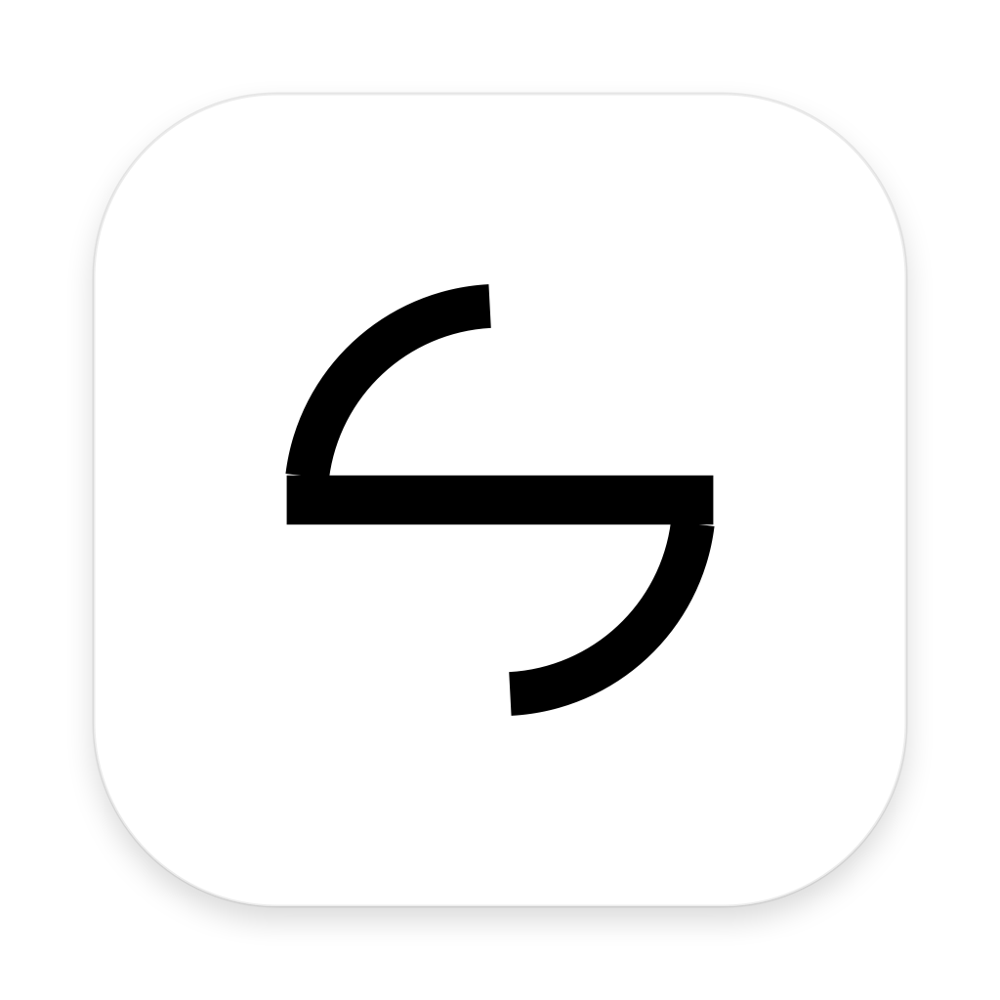
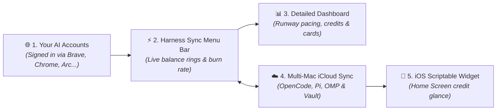

# ⚡️ Harness Sync

<p align="center">
  
</p>

<h3 align="center">The AI credit monitor, token burn calculator, and multi-Mac coding agent harness synchronizer for macOS.</h3>

<p align="center">
  <a href="https://apple.com/macos"></a>
  <a href="https://swift.org"></a>
  <a href="https://developer.apple.com"></a>
  <a href="#-privacy--security"></a>
  <a href="https://github.com/0xCosmosly/Harness-Sync/releases/latest"></a>
  <a href="LICENSE"></a>
</p>

<p align="center">
  <strong>Never run out of AI credits mid-prompt or lose your coding agent configuration across Macs.</strong><br />
  <b>Harness Sync</b> (formerly <i>API Bar</i>) lives in your macOS menu bar, continuously displaying live credit balances, token burn velocity, and runway estimates for all your AI inference providers—while seamlessly synchronizing your AI coding agent harnesses (OpenCode, Pi, and OMP) across your machines via your private iCloud Drive.
</p>

<p align="center">
  
  <br />
  <em><b>Menu Bar Experience</b>: Unified multi-provider overview (left) alongside detailed individual runway and pacing inspection (right).</em>
</p>

---

## 📑 Table of Contents

- [Key Features](#-key-features)
- [Coding Agent & Harness Sync](#-coding-agent--harness-sync)
- [Screenshots & Visual Tour](#-screenshots--visual-tour)
- [Supported Platforms](#-supported-platforms)
- [How It Works](#-how-it-works)
- [Download & Installation](#-download--installation)
- [Privacy & Security](#-privacy--security)
- [FAQ](#-faq)
- [Developer & Architecture Guide](#-developer--architecture-guide)
- [License](#-license)

---

## ✨ Key Features

- ⚡️ **Live Menu Bar Status**: View live percentage rings, remaining USD amounts, or microdollar balances directly in your menu bar.
- ⏱️ **Runway & Burn Velocity**: Real-time pacing estimates calculated from your active usage (e.g. `1.9M tokens/day · Runs out in 3 days`) so you are never caught off guard.
- ☁️ **Coding Agent Harness Sync**: Keep your model configs, credentials, and settings synchronized across all your Macs for **OpenCode**, **Pi**, and **OMP** (Oh My OpenCode / Oh My Prompt).
- 🤖 **Smart Sync Summaries**: The dedicated Sync tab reports real-time changes across your machines (e.g. `Mistral added with 3 models (2 hours ago)`), enhanced with on-device Apple Foundation Models with instant deterministic fallback.
- 🔑 **Zero-API-Key Browser Session Import**: Automatically connects to your existing signed-in browser sessions (Brave, Google Chrome, Arc, Microsoft Edge, Vivaldi, Chromium). No hunting down administrative secret keys.
- 📱 **iPhone & iPad Scriptable Widget**: Mirror your active desktop gauges, token runways, and CodexBar quotas right on your iOS Home Screen via iCloud.
- 🎛️ **Single or Individual Menu Bar Icons**: Combine all AI platforms into one smart, compact gauge or pin individual branded provider badges side-by-side.
- ⏸️ **Pause Instead of Delete**: Switch any provider or harness off to stop polling while keeping its configuration, saved sessions, and sort order intact.
- 🪄 **Add Any AI API in Seconds**: Paste a cURL command or JSON payload from any provider (OpenRouter, Groq, Together, DeepSeek, local Ollama/vLLM), and on-device intelligence parses it automatically.
- 🎯 **Automatic 100% Baseline Targets**: Intelligently detects deposits, top-ups, and promo grants to calculate remaining percentage capacity accurately.
- 🔄 **Built-in Self-Updater & Offline Changelog**: Check for updates and read release notes directly inside the native app with zero interruption.
- 🔒 **100% Private & Local**: Zero telemetry, zero analytics, zero middleman proxy servers. Requests connect directly from your Mac to official provider endpoints.

---

## ☁️ Coding Agent & Harness Sync

For engineers using modern AI coding agents across multiple machines (e.g. an M-series MacBook Pro and a desktop Mac Studio), keeping tools and model configurations in sync is traditionally painful. **Harness Sync** automates this via your encrypted, private iCloud Drive:

| Coding Harness | Synced Artifacts | Safety & Reliability |
| :--- | :--- | :--- |
| **OMP** *(Oh My OpenCode / Oh My Prompt)* | `models.yml`, `config.yml`, prompts | Atomic sync with automatic `.bak` safety rollbacks |
| **Pi Coding Agent** | `models.json`, agent presets | Non-blocking background diffing & merge |
| **OpenCode** | `opencode.json` configuration | Timestamped snapshots prior to applying remote state |
| **Session Vault** | Provider session tokens (`.dat`) | Encrypted local storage with isolated machine fingerprints |

> 💡 **Non-Blocking Guarantee**: Sync operations run in detached background tasks. Whether iCloud takes 100ms or 10 seconds to sync, your menu bar never freezes or drops frames.

---

## 📸 Screenshots & Visual Tour

<p align="center">
  
  <br />
  <em><b>Native macOS App Windows</b>: Guided 30-second setup tour (left) and built-in native markdown changelog with one-click updates (right).</em>
</p>

<details>
<summary><b>⚙️ View Settings & Browser Session Management</b></summary>
<br />
<p align="center">
  
  <br />
  <em><b>Settings Pane</b>: Manage browser connections, toggle iCloud sync, adjust provider sorting, and configure custom endpoints.</em>
</p>
</details>

---

## 🚀 Supported Platforms

| Platform | What Harness Sync Displays | Connection Source | Baseline Target |
| :--- | :--- | :--- | :--- |
| **Google Cloud / Vertex AI** | Active billing account credits & promotional grants | Browser session (SAPISID) | Initial grant total |
| **Fireworks AI** | Inference balance & prepaid developer credits | Browser session (`auth_token`) | Latest top-up |
| **Cerebras** | High-speed inference credits & quota tier | Browser session (`auth_token`) | Quota tier / top-up |
| **Google AI Studio** | Token credits, project allocation & developer quota | Browser session (`__Secure-` auth) | Project allocation |
| **Venice AI** | Dual consumption balances (USD fiat & DIEM token) | Browser session or Bearer key | Inferred baseline |
| **Refuseless** | Prepaid USD balance, deposit ledger & burn velocity | Browser session | Total deposits sum |
| **Lutheos** | Private inference prepaid balance & runway pacing | Browser session or Bearer key | Credited top-up tier |
| **Unaligned** | Prepaid USD balance (micro-dollar precision) | Browser session (dashboard) | Crypto top-up ledger |
| **Crowbot** | Chat & API usage credits (microdollar precision) | Browser session (`crowbot_session`) | Account quota |
| **Yeta** | Prepaid gateway credit (ships paused) | Browser session (console) | Remaining + spent quota |
| **Heimdallm** | AI platform inference credits | Browser session (`__Host-heimdallm_session`) | Total cycle credits |
| **InferHub** | AI inference credit balance & token pacing | Browser session (cookies) | Account tier |
| **Coding Harness Sync** | OpenCode, Pi, and OMP configuration & credential vault | Apple iCloud Drive container | Automatic `.bak` safety |
| **Custom / Any AI API** | OpenRouter, Groq, Together, DeepSeek, Local Ollama | cURL / JSON via on-device extractor | Custom reference |

---

## 🧠 How It Works



1. **Automatic Session Discovery**: Harness Sync discovers your active browser profile on-device and reads your authenticated session cookies locally using macOS Keychain encryption—no need to generate or rotate administrative API keys.
2. **Real-Time Burn Rate & Runway**: Beyond raw balances, Harness Sync analyzes your recent token usage velocity and projects how many hours or days remain before your credits exhaust.
3. **Coding Agent Harness Syncing**: Keep your AI coding agents configured identically across all your Macs. Changes to models or prompts are detected, diffed, summarized, and propagated seamlessly via iCloud Drive.
4. **Completely Local & Private**: All balance checks happen directly between your Mac and official AI provider endpoints. No middleman servers, no proxy relays, and zero telemetry.

---

## 📥 Download & Installation

### Option 1: Direct Download (Recommended)

1. Download the latest **`APIBar-app.zip`** from [GitHub Releases](https://github.com/0xCosmosly/Harness-Sync/releases/latest).
2. Unzip and drag **`Harness Sync.app`** into your **`/Applications`** folder.
3. Launch **Harness Sync** and follow the quick 3-step setup tour:
   - **Step 1: Select Platforms**: Choose the AI providers you want to track.
   - **Step 2: Connect Browser**: Select your browser profile and grant access (**Folder Access Only** or **Full Disk Access**).
   - **Step 3: Menu Bar Preferences**: Choose whether to display individual status gauges or a single merged icon.

### System Requirements

- **Operating System**: macOS 13.0 (Ventura), macOS 14.0 (Sonoma), macOS 15.0 (Sequoia), or later.
- **Hardware Architecture**: Native **Apple Silicon** (M1, M2, M3, M4, or later).

---

## 🔒 Privacy & Security

Harness Sync is built from the ground up for security-conscious developers and teams:

- **100% Local Execution**: No analytics, telemetry, tracking pixels, or remote logging.
- **Direct HTTPS Networking**: Requests travel directly from your Mac to official AI platform endpoints. No proxy servers, relays, or intermediary cloud services.
- **Encrypted Local Storage**: Session tokens and authentication headers are stored in your encrypted macOS Keychain under service name `app.apibar.APIBar`.
- **Zero Background Popups**: Background balance refreshes run in non-interactive mode (`interactionNotAllowed = true`), ensuring the app never interrupts you with Keychain authorization prompts.
- **Safe iCloud Storage**: All synchronized configs live exclusively inside your personal, encrypted Apple iCloud Drive container (`iCloud~app~apibar~APIBar`).

---

## ❓ FAQ

**Q: Do I need to generate API keys for every provider?**  
No. For natively supported providers (Vertex AI, Fireworks, Cerebras, Google AI Studio, Refuseless, Lutheos, Unaligned, Yeta, Crowbot, Venice AI, Heimdallm, InferHub), Harness Sync reads your existing signed-in browser session. You can also provide manual Bearer tokens if preferred.

**Q: Which browsers are supported for automatic session import?**  
Harness Sync automatically detects your primary browser and supports **Brave Browser**, **Google Chrome**, **Arc**, **Microsoft Edge**, **Vivaldi**, and **Chromium**.

**Q: What is the difference between Folder Access Only and Full Disk Access?**  
- **Folder Access Only**: Lets you grant permission strictly to your browser profile folder (e.g. `~/Library/Application Support/BraveSoftware/Brave-Browser`) without opening macOS System Settings.
- **Full Disk Access**: Grants system-wide permission so Harness Sync can read browser profiles automatically across browser updates and path changes.

**Q: How does the 100% baseline gauge work?**  
Harness Sync inspects your provider account's initial credit allocation or latest deposit. If you top up or receive a new grant, Harness Sync automatically adjusts the 100% capacity reference so your percentage gauge reflects actual remaining funds.

**Q: Can I track unlisted AI APIs?**  
Yes. Open **Settings → Add Custom Provider**. Enter the provider's name or paste a cURL command from their documentation; on-device intelligence parses the endpoint structure, auth headers, and response balance fields automatically.

**Q: How does Coding Agent Harness Sync work?**  
When enabled in the **Sync** tab or Settings, Harness Sync watches local config directories for OpenCode, Pi, and OMP. Changes made on one Mac are safely mirrored to your other Macs via your personal iCloud Drive, complete with pre-write `.bak` safety backups.

---

<details>
<summary><b>🛠️ Developer & Architecture Guide (For Contributors & Agents)</b></summary>

> 🤖 **Working with an AI coding assistant?** See the full [Agent Guide & Architecture Specification (AGENTS.md)](AGENTS.md) for architectural invariants, zero-secret rules, and provider recipes.

### Repository Structure

```
Harness-Sync/
├── Package.swift                    # Swift Package Manager manifest (macOS 13+)
├── build.command                    # Apple Silicon release build & packaging script
├── check.command                    # Sandboxed test suite runner (zero side effects)
├── Resources/
│   ├── Info.plist                   # App metadata & bundle configuration
│   ├── AppIcon.icns                 # High-resolution multi-size app icon
│   └── *-mask.png                   # 1x/2x/3x vector template silhouettes
├── Sources/
│   ├── Main.swift                   # Entry point (NSApplication bootstrap)
│   ├── App.swift                    # Coordinator, status items & state
│   ├── Credentials.swift            # Browser detection, SQLite reader, AES decryptor
│   ├── SessionHTTP.swift            # Cookie-authenticated networking & SAPISID hashing
│   ├── GoogleProvider.swift         # Google Cloud & Vertex AI GraphQL credit client
│   ├── CrowbotProvider.swift        # Crowbot microdollar credit extractor
│   ├── AFMProviderExtractor.swift   # On-device heuristic balance parser
│   ├── AFMSummarizer.swift          # On-device Foundation Model sync summarizer
│   ├── Provider.swift               # BalanceProvider protocols & reading models
│   ├── ProviderTabsView.swift       # Menu bar drop-down tab bar and popover views
│   ├── MenuUI.swift                 # SwiftUI views (Settings, Onboarding, Paper badges)
│   ├── BrandMark.swift              # Custom vector graphics & icon renderers
│   ├── ICloudSync.swift             # CloudKit / NSUbiquitousKeyValueStore engine
│   ├── SyncChangeLog.swift          # Precise YAML/JSON diffing & change summaries
│   ├── Changelog.swift              # Full version history & offline markdown changelog
│   └── AppUpdater.swift             # GitHub Releases in-app self-updater
└── Tests/
    ├── Checks.swift                 # Comprehensive unit & regression tests
    ├── UIInteractionChecks.swift    # Headless AppKit/SwiftUI component tests
    └── ConnectionDiagnostic.swift   # Live connection verification harness
```

### Running Tests

To run the complete sandboxed verification suite without touching real user data or Keychain:

```sh
./check.command
```

### Building & Packaging

To compile the native Apple Silicon binary and package `APIBar-app.zip`:

```sh
./build.command
```

</details>

---

## 📄 License & Attribution

- **Design Inspiration**: Menu styling and provider concepts inspired by [CodexBar](https://github.com/steipete/CodexBar) (MIT).
- **License**: MIT License. See [LICENSE](LICENSE) for details.
- **Disclaimer**: Independent open-source project. Not affiliated with, sponsored by, or endorsed by Google, Fireworks AI, Cerebras, Brave Software, or The Browser Company.
