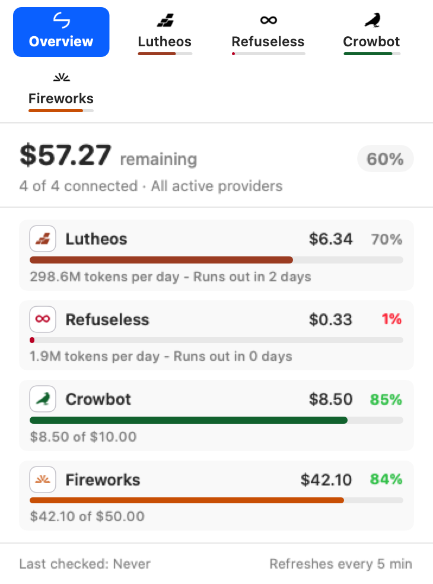
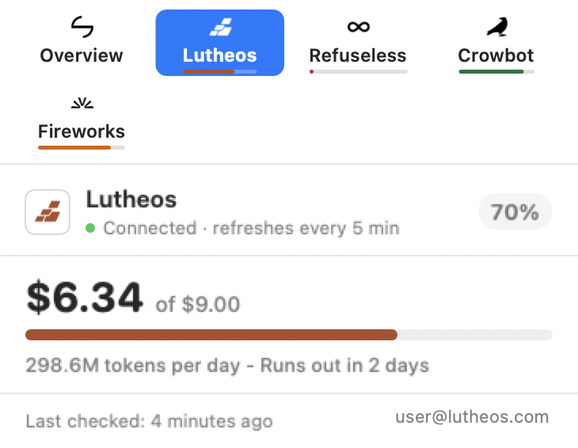

# ⚡️ Harness Sync

<p align="center">
  
</p>

<h3 align="center">The AI credit monitor, token burn calculator, and multi-Mac coding agent harness synchronizer for macOS.</h3>

<p align="center">
  <a href="https://apple.com/macos"></a>
  <a href="https://swift.org"></a>
  <a href="https://developer.apple.com"></a>
  <a href="#-privacy--security"></a>
  <a href="https://github.com/0xCosmosly/Harness-Sync/releases/latest"></a>
  <a href="LICENSE"></a>
</p>

<p align="center">
  <strong>Never run out of AI credits mid-prompt or lose your coding agent configurations when switching Macs.</strong><br />
  <b>Harness Sync</b> (formerly <i>API Bar</i>) lives in your macOS menu bar, continuously displaying live credit balances, token burn velocity, and runway estimates for all your AI inference providers—while seamlessly synchronizing your AI coding agent harnesses (OpenCode, Pi, and OMP) across your machines via your private iCloud Drive.
</p>

<p align="center">
  
  <br />
  <em><b>Menu Bar Experience</b>: Unified multi-provider overview (left) alongside detailed individual runway and pacing inspection (right).</em>
</p>

---

## 📑 Table of Contents

- [✨ Why You'll Love Harness Sync](#-why-youll-love-harness-sync)
- [🚀 Quick Start: Installation & 30-Second Tour](#-quick-start-installation--30-second-tour)
- [📊 User Guide: Menu Bar & Popover Dashboard](#-user-guide-menu-bar--popover-dashboard)
- [☁️ User Guide: The Sync Tab & Coding Agent Harnesses](#-user-guide-the-sync-tab--coding-agent-harnesses)
- [📱 User Guide: iPhone & iPad Scriptable Widget](#-user-guide-iphone--ipad-scriptable-widget)
- [🔑 User Guide: Zero-API-Key Browser Session Import](#-user-guide-zero-api-key-browser-session-import)
- [🪄 User Guide: Adding Custom Providers via cURL](#-user-guide-adding-custom-providers-via-curl)
- [🗺️ Supported Platforms](#-supported-platforms)
- [🔒 Privacy & Security](#-privacy--security)
- [❓ Frequently Asked Questions (FAQ)](#-frequently-asked-questions-faq)
- [🛠️ Developer & Agent Guide](#️-developer--agent-guide)
- [📄 License & Attribution](#-license--attribution)

---

## ✨ Why You'll Love Harness Sync

- ⚡️ **Live Menu Bar Status**: View live percentage rings, remaining USD amounts, or microdollar balances at a glance.
- ⏱️ **Runway & Burn Velocity**: Real-time pacing estimates calculated from your active usage (e.g. `1.9M tokens/day · Runs out in 3 days`) so you are never caught off guard.
- ☁️ **Coding Agent Harness Sync**: Keep your model configs, credentials, and settings synchronized across all your Macs for **OpenCode**, **Pi**, and **OMP** (Oh My OpenCode / Oh My Prompt).
- 🤖 **Smart Sync Summaries**: The dedicated Sync tab reports real-time changes across your machines (e.g. `Mistral added with 3 models (2 hours ago)`), enhanced with on-device Apple Foundation Models with instant deterministic fallback.
- 🔑 **Zero-API-Key Browser Session Import**: Automatically connects to your existing signed-in browser sessions (Brave, Google Chrome, Arc, Microsoft Edge, Vivaldi, Chromium). No hunting down administrative secret keys.
- 📱 **iPhone & iPad Scriptable Widget**: Mirror your active desktop gauges, token runways, and CodexBar quotas right on your iOS Home Screen via iCloud.
- 🎛️ **Single or Individual Menu Bar Icons**: Combine all AI platforms into one smart, compact gauge or pin individual branded provider badges side-by-side.
- ⏸️ **Pause Instead of Delete**: Switch any provider or harness off to stop polling while keeping its configuration, saved sessions, and sort order intact.
- 🪄 **Add Any AI API in Seconds**: Paste a cURL command or JSON payload from any provider (OpenRouter, Groq, Together, DeepSeek, local Ollama/vLLM), and on-device intelligence parses it automatically.
- 🎯 **Automatic 100% Baseline Targets**: Intelligently detects deposits, top-ups, and promo grants to calculate remaining percentage capacity accurately.
- 🔄 **Built-in Self-Updater & Offline Changelog**: Check for updates and read release notes directly inside the native app with zero interruption.
- 🔒 **100% Private & Local**: Zero telemetry, zero analytics, zero middleman proxy servers. Requests connect directly from your Mac to official provider endpoints.

---

## 🚀 Quick Start: Installation & 30-Second Tour

### 1. Download & Install

1. Download the latest **`APIBar-app.zip`** from [GitHub Releases](https://github.com/0xCosmosly/Harness-Sync/releases/latest).
2. Unzip and drag **`Harness Sync.app`** into your macOS **`/Applications`** folder.
3. Open **Harness Sync** from Applications or Spotlight.

> [!NOTE]
> Harness Sync requires an **Apple Silicon Mac** (M1, M2, M3, M4, or later) running **macOS 13.0 (Ventura)**, **macOS 14.0 (Sonoma)**, **macOS 15.0 (Sequoia)**, or later.

<p align="center">
  
  <br />
  <em><b>Native Setup Tour</b>: Guided 30-second setup tour (left) and built-in native markdown changelog with one-click updates (right).</em>
</p>

### 2. The 30-Second Setup Tour

When you first launch the app, a 3-step setup tour guides you through:
- **Step 1: Select Platforms**: Choose the AI providers you actively use (Google Cloud/Vertex, Fireworks, Cerebras, Google AI Studio, Refuseless, Lutheos, Venice, etc.).
- **Step 2: Connect Browser**: Select your preferred browser profile (Brave, Chrome, Arc, Edge, Vivaldi) and choose either **Folder Access Only** or **Full Disk Access**.
- **Step 3: Menu Bar Preferences**: Choose whether to display individual status gauges for each provider or merge them into a single smart icon.

---

## 📊 User Guide: Menu Bar & Popover Dashboard

<p align="center">
  
  &nbsp;&nbsp;&nbsp;&nbsp;
  
</p>

### Understanding Gauges & Metrics
- **Overview Card**: Displays the aggregate total of all active providers, your top platforms by spend, and the latest iCloud sync status.
- **Provider Cards**: Click any provider tab to view:
  - **Remaining Balance**: Live balance formatted in USD or token credits.
  - **Token Burn Rate**: Average daily consumption velocity calculated over active usage days (e.g. `24.1M tokens/day`).
  - **Runway Estimator**: Exact projection of remaining runway (e.g. `Runs out in 2 days` or `· 2d runway`).
  - **Percentage Gauge**: Visual ring showing remaining capacity against your active billing cycle.

### Dynamic 100% Cycle Baselines
Unlike static quota bars, Harness Sync continuously tracks top-up cycles:
- When you receive a promotional grant or deposit new funds (e.g. topping up \$10 after spending down a \$25 balance), Harness Sync automatically recalculates your cycle capacity reference so 100% corresponds to actual new available funds rather than cumulative lifetime spend.

### Presentation Modes: Merged vs. Discrete Gauges
In **Settings → Menu Bar Presentation**:
- **Merged Icon**: Shows a single, elegant icon with your aggregate balance percentage ring.
- **Discrete Icons**: Pins individual branded icons side-by-side in your menu bar so you can monitor multiple providers simultaneously.
- **Pause Providers**: Click the pause toggle on any provider to temporarily stop background polling without deleting your credentials or configuration.

---

## ☁️ User Guide: The Sync Tab & Coding Agent Harnesses

<p align="center">
  
  <br />
  <em><b>Settings & Sync Management</b>: Toggle iCloud sync, enable OpenCode, Pi, and OMP, and view cross-machine sync status.</em>
</p>

If you use multiple Macs (such as a MacBook Pro for travel and a Mac Studio at your desk), Harness Sync keeps your AI coding agents perfectly synchronized over your private Apple iCloud Drive.

### The Sync Tab Card
When iCloud Sync is enabled, a dedicated **Sync** tab appears immediately to the right of Overview in your popover:
1. **Status Badge**: Displays `Active` or `Synced` with green pulse indicators.
2. **Enabled Harnesses**: Clean checklist showing active integrations:
   - `Harness - OMP`
   - `Harness - Pi`
   - `Harness - OpenCode`
   - `Providers & Models`
   - `Scriptable Widget`
3. **Last Synced Timestamp**: Shows the source machine name and timestamp:
   ```
   Last synced from MacBook Pro 11:42 AM (2 hours ago)
   ```
4. **Headline Change Summary**: A dedicated two-line box detailing the exact configuration change applied:
   ```
   Mistral added with 3 models
   ```
   *(Routine balance fluctuations and session heartbeats are silenced so you always see the last meaningful update).*

### Supported Coding Agent Harnesses

| Coding Harness | Local Configuration Path | What Syncs Across Macs |
| :--- | :--- | :--- |
| **OMP** *(Oh My OpenCode / Oh My Prompt)* | `~/.omp/models.yml`<br/>`~/.omp/config.yml` | Model definitions, custom providers, prompts, and settings |
| **Pi Coding Agent** | `~/.pi/models.json` | Agent presets, provider endpoints, and model configurations |
| **OpenCode** | `~/.config/opencode/opencode.json` | Global OpenCode configuration, defaults, and provider keys |
| **Credential Vault** | Local encrypted Keychain | Optional: Session tokens (`.dat`) for headless agent auth |

### How to Enable Coding Agent Sync
1. Click the Harness Sync menu bar icon and open **Settings** (gear icon).
2. Toggle **Sync with iCloud Drive**.
3. Under **Sync Coding Agents (Optional)**, check the harnesses you use:
   - ☑️ **OpenCode**
   - ☑️ **Pi**
   - ☑️ **OMP**
4. *(Optional)* Check **Sync API keys & credentials** if you want your credential vault mirrored across machines.

> [!TIP]
> **Safety First**: Harness Sync creates an automatic `.bak` safety backup before writing any incoming changes from iCloud. Your original files are never overwritten without a recovery copy.

---

## 📱 User Guide: iPhone & iPad Scriptable Widget

Mirror your live macOS menu bar gauges, remaining credits, and token runway pacing directly to your iPhone or iPad Home Screen via iCloud.

<p align="center">
  <b>Home Screen Format:</b> <code>AI Usage · $x / x% left</code> with automatic iOS Light/Dark mode.
</p>

### Step-by-Step iOS Widget Setup

1. **Enable in Desktop App**:
   - Open Harness Sync **Settings** on your Mac.
   - Under iCloud, toggle **Sync with iPhone (Scriptable Widget)**.
   - Harness Sync will automatically generate and maintain `API Bar.js` in your iCloud Drive Scriptable directory (`iCloud/Scriptable/API Bar.js`).
2. **Install Scriptable on iPhone / iPad**:
   - Download the free [Scriptable app](https://apps.apple.com/app/scriptable/id1405459188) from the App Store.
3. **Open Scriptable**:
   - Launch Scriptable once on your iPhone. Thanks to iCloud, **`API Bar`** will automatically appear in your scripts list.
4. **Add the Home Screen Widget**:
   - Go to your iPhone Home Screen, touch and hold an empty area until the apps jiggle.
   - Tap the **`+`** button in the upper-left corner.
   - Search for **Scriptable** and choose your preferred widget size (**Small**, **Medium**, or **Large**).
   - Tap **Add Widget**.
5. **Configure the Widget**:
   - Tap the widget while apps are jiggling (or long-press it and choose **Edit Widget**).
   - In the **Script** parameter, select **`API Bar`**.
   - In **When Interacting**, choose **Run Script** or **Open App**.
6. **Done!** Your Home Screen widget will now automatically update in the background with live credit balances and runway estimates from your Mac.

---

## 🔑 User Guide: Zero-API-Key Browser Session Import

Generating, storing, and rotating administrative API keys is tedious and risky. Harness Sync bypasses manual keys by reading your existing signed-in browser sessions locally on your Mac.

### How It Works
1. You sign in to provider consoles (e.g. Vertex AI in Google Cloud Console, Fireworks AI, Cerebras, Google AI Studio) in your regular web browser.
2. Harness Sync accesses your browser's local cookie database (`Cookies.binarycookies` or SQLite `Cookies`).
3. It retrieves the browser master key from your encrypted **macOS Keychain** (`Brave Safe Storage`, `Chrome Safe Storage`, etc.) and decrypts the session token in memory via AES-128-CBC.
4. It calls official usage endpoints directly via HTTPS.

### Folder Access Only vs. Full Disk Access
- **Folder Access Only (Recommended for Quick Setup)**:
  - Prompts you once to select your browser's application support directory (e.g. `~/Library/Application Support/BraveSoftware/Brave-Browser`).
  - Stores a secure macOS security-scoped bookmark. No system settings modification needed.
- **Full Disk Access (Recommended for Seamless Updates)**:
  - Grants read access via macOS **System Settings → Privacy & Security → Full Disk Access**.
  - Prevents permission resets when browsers update or change internal paths.

---

## 🪄 User Guide: Adding Custom Providers via cURL

Track any unlisted AI platform, private inference server, or local model runner (OpenRouter, Groq, Together, DeepSeek, local Ollama, vLLM) in seconds:

1. Copy an example `curl` command from the provider's official documentation or usage API page.
2. In Harness Sync, open **Settings → Add Custom Provider**.
3. Paste the cURL snippet into the input box:
   ```sh
   curl https://openrouter.ai/api/v1/auth/key      -H "Authorization: Bearer sk-or-v1-..."
   ```
4. On-device heuristics automatically identify:
   - Target API endpoint
   - Authorization headers and bearer tokens
   - JSON response paths for remaining balances and credit limits
5. Give it a name and click **Add Provider**. A custom monogram icon will appear immediately in your menu bar.

---

## 🗺️ Supported Platforms

| Platform | What Harness Sync Displays | Connection Source | Baseline Target |
| :--- | :--- | :--- | :--- |
| **Google Cloud / Vertex AI** | Active billing account credits & promotional grants | Browser session (SAPISID) | Initial grant total |
| **Fireworks AI** | Inference balance & prepaid developer credits | Browser session (`auth_token`) | Latest top-up |
| **Cerebras** | High-speed inference credits & quota tier | Browser session (`auth_token`) | Quota tier / top-up |
| **Google AI Studio** | Token credits, project allocation & developer quota | Browser session (`__Secure-` auth) | Project allocation |
| **Venice AI** | Dual consumption balances (USD fiat & DIEM token) | Browser session or Bearer key | Inferred baseline |
| **Refuseless** | Prepaid USD balance, deposit ledger & burn velocity | Browser session | Total deposits sum |
| **Lutheos** | Private inference prepaid balance & runway pacing | Browser session or Bearer key | Credited top-up tier |
| **Unaligned** | Prepaid USD balance (micro-dollar precision) | Browser session (dashboard) | Crypto top-up ledger |
| **Crowbot** | Chat & API usage credits (microdollar precision) | Browser session (`crowbot_session`) | Account quota |
| **Yeta** | Prepaid gateway credit (ships paused) | Browser session (console) | Remaining + spent quota |
| **Heimdallm** | AI platform inference credits | Browser session (`__Host-heimdallm_session`) | Total cycle credits |
| **InferHub** | AI inference credit balance & token pacing | Browser session (cookies) | Account tier |
| **Coding Harness Sync** | OpenCode, Pi, and OMP configuration & credential vault | Apple iCloud Drive container | Automatic `.bak` safety |
| **Custom / Any AI API** | OpenRouter, Groq, Together, DeepSeek, Local Ollama | cURL / JSON via on-device extractor | Custom reference |

---

## 🔒 Privacy & Security

Harness Sync is built specifically for security-conscious developers and corporate environments:

- **100% Local Execution**: No analytics, telemetry, tracking pixels, or remote logging.
- **Direct HTTPS Networking**: Requests travel directly from your Mac to official AI platform endpoints. No proxy servers, relays, or intermediary cloud services.
- **Encrypted Local Storage**: Session tokens and authentication headers are stored in your encrypted macOS Keychain under service name `app.apibar.APIBar`.
- **Zero Background Popups**: Background balance refreshes run in non-interactive mode (`interactionNotAllowed = true`), ensuring the app never interrupts you with Keychain authorization prompts.
- **Safe iCloud Storage**: All synchronized configs live exclusively inside your personal, encrypted Apple iCloud Drive container (`iCloud~app~apibar~APIBar`).

---

## ❓ Frequently Asked Questions (FAQ)

**Q: Do I need to generate API keys for every provider?**  
No. For natively supported providers (Vertex AI, Fireworks, Cerebras, Google AI Studio, Refuseless, Lutheos, Unaligned, Yeta, Crowbot, Venice AI, Heimdallm, InferHub), Harness Sync reads your existing signed-in browser session. You can also provide manual Bearer tokens if preferred.

**Q: Which browsers are supported for automatic session import?**  
Harness Sync automatically detects your primary browser and supports **Brave Browser**, **Google Chrome**, **Arc**, **Microsoft Edge**, **Vivaldi**, and **Chromium**.

**Q: What is the difference between Folder Access Only and Full Disk Access?**  
- **Folder Access Only**: Lets you grant permission strictly to your browser profile folder (e.g. `~/Library/Application Support/BraveSoftware/Brave-Browser`) without opening macOS System Settings.
- **Full Disk Access**: Grants system-wide permission so Harness Sync can read browser profiles automatically across browser updates and path changes.

**Q: How does the 100% baseline gauge work?**  
Harness Sync inspects your provider account's initial credit allocation or latest deposit. If you top up or receive a new grant, Harness Sync automatically adjusts the 100% capacity reference so your percentage gauge reflects actual remaining funds.

**Q: Can I track unlisted AI APIs?**  
Yes. Open **Settings → Add Custom Provider**. Enter the provider's name or paste a cURL command from their documentation; on-device intelligence parses the endpoint structure, auth headers, and response balance fields automatically.

**Q: How does Coding Agent Harness Sync work?**  
When enabled in the **Sync** tab or Settings, Harness Sync watches local config directories for OpenCode, Pi, and OMP. Changes made on one Mac are safely mirrored to your other Macs via your personal iCloud Drive, complete with pre-write `.bak` safety backups.

**Q: How often do balances refresh?**  
Balances refresh automatically in the background every 5 minutes. You can also click **Refresh** or **Refresh All** in the menu bar popover at any time to update immediately.

**Q: What should I do if a provider says "Connect in Settings"?**  
This means your browser session cookie has expired or was signed out. Simply visit the provider's console in your browser, log back in, and Harness Sync will automatically recover on the next refresh cycle.

---

## 🛠️ Developer & Agent Guide

Are you contributing to Harness Sync or running an automated AI coding assistant (Gemini, Claude Code, Cursor, Codex, Antigravity, Aider)?

See the comprehensive **[Agent Guide & Architecture Specification (AGENTS.md)](AGENTS.md)** for:
- Core architectural invariants and security protocols
- Non-interactive Keychain execution rules
- Sandboxed test suite runner (`./check.command`)
- Apple Silicon build & packaging pipeline (`./build.command`)
- 4-step recipe for adding new native AI providers

### Quick Verification & Build

```sh
# Run the complete sandboxed verification suite (18 check suites, zero side-effects):
./check.command

# Compile native Apple Silicon release binary and package APIBar-app.zip:
./build.command
```

---

## 📄 License & Attribution

- **Design Inspiration**: Menu styling and provider concepts inspired by [CodexBar](https://github.com/steipete/CodexBar) (MIT).
- **License**: MIT License. See [LICENSE](LICENSE) for details.
- **Disclaimer**: Independent open-source project. Not affiliated with, sponsored by, or endorsed by Google, Fireworks AI, Cerebras, Brave Software, or The Browser Company.
