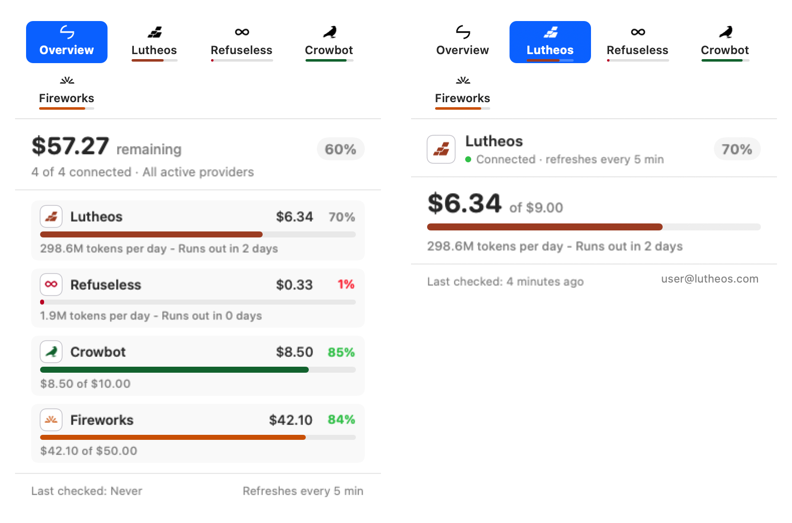
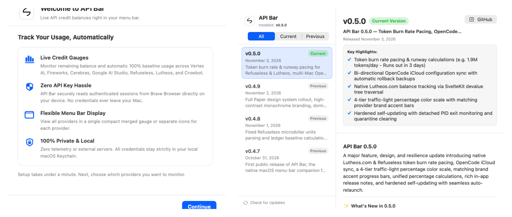
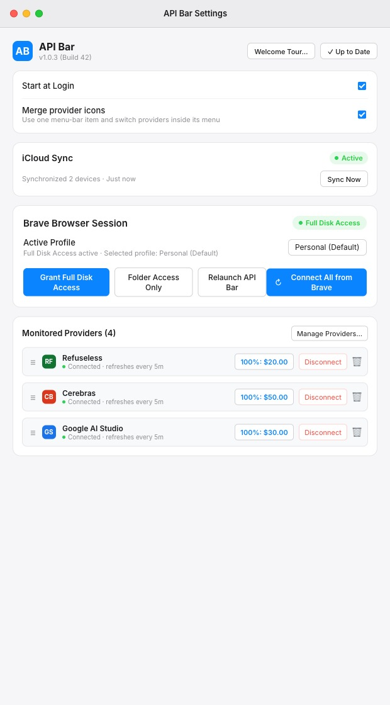
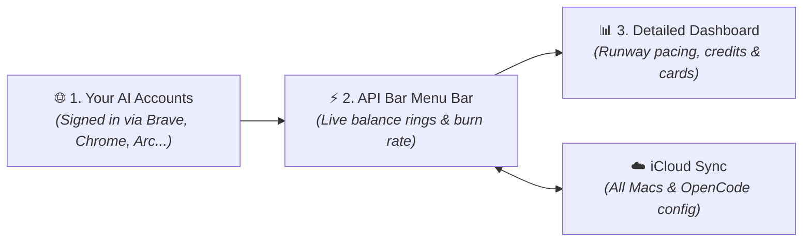

# ⚡️ API Bar

<p align="center">
  
</p>

<h3 align="center">The AI credit and balance tracker for your macOS menu bar.</h3>

<p align="center">
  <a href="https://apple.com/macos"></a>
  <a href="https://swift.org"></a>
  <a href="https://developer.apple.com"></a>
  <a href="#-privacy--security"></a>
  <a href="LICENSE"></a>
</p>

<p align="center">
  <strong>Never run out of AI credits mid-prompt again.</strong><br />
  API Bar lives in your menu bar alongside your daily tools, continuously displaying live credit balances, token burn velocity, and runway estimates for all your AI platforms.
</p>

<p align="center">
  
  <br />
  <em><b>Menu Bar Experience</b>: Unified multi-provider overview (left) alongside detailed individual runway and pacing inspection (right).</em>
</p>

---

## 📑 Table of Contents

- [Why You'll Love API Bar](#-why-youll-love-api-bar)
- [Screenshots & Visual Tour](#-screenshots--visual-tour)
- [Supported Platforms](#-supported-platforms)
- [How It Works](#-how-it-works)
- [Download & Installation](#-download--installation)
- [Privacy & Security](#-privacy--security)
- [FAQ](#-faq)
- [Developer & Architecture Guide](#-developer--architecture-guide)
- [License](#-license)

---

## ✨ Why You'll Love API Bar

- ⚡️ **Live Menu Bar Status**: View live percentage rings, remaining dollar amounts, or microdollar balances at a glance.
- ⏱️ **Runway & Burn Velocity**: Real-time pacing estimates calculated from your actual usage (e.g. `1.9M tokens/day · Runs out in 3 days`) so you're never caught off guard.
- 🔑 **Zero API Key Hassle**: Automatically connects to your signed-in browser sessions (Brave, Google Chrome, Arc, Microsoft Edge, Vivaldi, Chromium). No hunting down administrative secret keys.
- 🎛️ **Single or Individual Icons**: Merge all your AI platforms into one smart, compact menu bar gauge or pin individual provider badges side-by-side.
- ⏸️ **Pause Instead of Delete**: Switch a provider off to stop tracking it while keeping its settings, saved session and position in the list.
- ☁️ **iCloud Sync Across Macs**: Monitored platforms, baseline targets, and optional OpenCode configs (`opencode.json`) automatically sync between your desktop and laptop via your private iCloud Drive.
- 🪄 **Add Any AI API in Seconds**: Paste a cURL command or JSON payload from any provider (OpenRouter, Groq, Together, DeepSeek, local Ollama/vLLM), and on-device intelligence configures it automatically.
- 🎯 **Automatic 100% Baseline Targets**: Automatically detects top-ups, deposits, and trial grants to calculate remaining percentage capacity accurately.
- 🔄 **Built-in Updater & Changelog**: Check for updates and read release notes directly inside the app with zero interruption to your workflow.
- 🔒 **100% Private & Local**: Zero telemetry, zero analytics, zero middleman proxy servers. Requests connect directly from your Mac to official provider endpoints.

---

## 📸 Screenshots & Visual Tour

<p align="center">
  
  <br />
  <em><b>Native macOS App Windows</b>: Guided 30-second setup tour (left) and built-in native markdown changelog with one-click updates (right).</em>
</p>

<details>
<summary><b>⚙️ View Settings & Browser Session Management</b></summary>
<br />
<p align="center">
  
  <br />
  <em><b>Settings Pane</b>: Manage browser connections, toggle iCloud sync, adjust provider sorting, and configure custom endpoints.</em>
</p>
</details>

---

## 🚀 Supported Platforms

| Platform | What API Bar Displays | Connection Source | Baseline Target |
| :--- | :--- | :--- | :--- |
| **Google Cloud / Vertex AI** | Active billing account credits & promotional grants | Browser session (SAPISID) | Initial grant total |
| **Fireworks AI** | Inference balance & prepaid developer credits | Browser session (`auth_token`) | Latest top-up |
| **Cerebras** | High-speed inference credits & quota tier | Browser session (`auth_token`) | Quota tier / top-up |
| **Google AI Studio** | Token credits, project allocation & developer quota | Browser session (`__Secure-` auth) | Project allocation |
| **Refuseless** | Prepaid USD balance, deposit ledger & burn velocity | Browser session | Total deposits sum |
| **Lutheos** | Private inference prepaid balance & runway pacing | Browser session or Bearer key | Credited top-up tier |
| **Unaligned** | Prepaid USD balance (micro-dollar precision) | Browser session (dashboard) | Crypto top-up ledger |
| **Venice AI** | Dual consumption balances (USD fiat & DIEM token) | Browser session or Bearer key | Inferred baseline |
| **Crowbot** | Chat & API usage credits (microdollar precision) | Browser session (`crowbot_session`) | Account quota |
| **Yeta** | Prepaid gateway credit (ships paused) | Browser session (console) | Remaining + spent quota |
| **OpenCode Sync (Optional)** | Model & provider configuration synchronization | Apple iCloud Drive container | Automatic `.bak` safety |
| **Custom / Any AI API** | OpenRouter, Groq, Together, DeepSeek, Local Ollama | cURL / JSON via on-device extractor | Custom reference |

---

## 🧠 How It Works



1. **Automatic Session Discovery**: API Bar detects your active browser on-device. It reads your authenticated session cookies locally and securely via macOS Keychain encryption—no need to generate or rotate administrative API keys.
2. **Real-Time Burn Rate & Runway**: Beyond raw balances, API Bar calculates your real-world consumption pace and displays how many days or hours remain before your credits exhaust.
3. **Optional OpenCode Syncing**: If you use OpenCode, you can optionally sync your models and provider definitions across your machines with automatic rollback backups.
4. **Completely Local & Private**: All balance checks happen directly between your Mac and official AI provider endpoints. No middleman servers, no proxy servers, and zero telemetry.

---

## 📥 Download & Installation

### Option 1: Direct Download (Recommended)

1. Download the latest **`APIBar-app.zip`** from [GitHub Releases](https://github.com/0xCosmosly/API-Bar/releases/latest).
2. Unzip and drag **`API Bar.app`** into your **`/Applications`** folder.
3. Launch **API Bar** and follow the quick 3-step setup tour:
   - **Step 1: Select Platforms**: Choose the AI providers you want to track.
   - **Step 2: Connect Browser**: Select your browser profile and grant access (**Folder Access Only** or **Full Disk Access**).
   - **Step 3: Menu Bar Preferences**: Choose whether to display individual status gauges or a single merged icon.

### System Requirements

- **macOS 13.0 (Ventura)**, **macOS 14.0 (Sonoma)**, **macOS 15.0 (Sequoia)**, or later.
- Universal binary runs natively on **Apple Silicon** (M1/M2/M3/M4) and **Intel** Macs.

---

## 🔒 Privacy & Security

API Bar is built from the ground up for privacy-conscious developers:

- **100% Local**: No analytics, telemetry, tracking pixels, or remote logging.
- **Direct Networking**: Requests travel directly from your Mac to official AI platform endpoints. No proxy servers, relays, or intermediary cloud services.
- **Encrypted Local Storage**: Session tokens and authentication headers are stored in your encrypted macOS Keychain under service name `app.apibar.APIBar`.
- **Zero Background Popups**: Background balance refreshes run in non-interactive mode (`interactionNotAllowed = true`), ensuring the app never interrupts you with Keychain authorization prompts.

---

## ❓ FAQ

**Q: Do I need to generate API keys for every provider?**  
No. For natively supported providers (Vertex AI, Fireworks, Cerebras, Google AI Studio, Refuseless, Lutheos, Unaligned, Yeta, Crowbot), API Bar reads your existing signed-in browser session. You can also provide manual Bearer tokens if preferred.

**Q: Which browsers are supported for automatic session import?**  
API Bar automatically detects your primary browser and supports **Brave Browser**, **Google Chrome**, **Arc**, **Microsoft Edge**, **Vivaldi**, and **Chromium**.

**Q: What is the difference between Folder Access Only and Full Disk Access?**  
- **Folder Access Only**: Lets you grant permission strictly to your browser profile folder (e.g. `~/Library/Application Support/BraveSoftware/Brave-Browser`) without opening macOS System Settings.
- **Full Disk Access**: Grants system-wide permission so API Bar can read browser profiles automatically across browser updates and path changes.

**Q: How does the 100% baseline gauge work?**  
API Bar inspects your provider account's initial credit allocation or latest deposit. If you top up or receive a new grant, API Bar automatically adjusts the 100% capacity reference so your percentage gauge reflects actual remaining funds.

**Q: Can I track unlisted AI APIs?**  
Yes. Open **Settings → Add Custom Provider**. Enter the provider's name or paste a cURL command from their documentation; on-device intelligence parses the endpoint structure, auth headers, and response balance fields automatically.

---

<details>
<summary><b>🛠️ Developer & Architecture Guide (For Contributors & Agents)</b></summary>

> 🤖 **Working with an AI coding assistant?** See the full [Agent Guide & Architecture Specification (AGENTS.md)](AGENTS.md) for architectural invariants, zero-secret rules, and provider recipes.

### Repository Structure

```
API Bar/
├── Package.swift                    # Swift Package Manager manifest (macOS 13+)
├── build.command                    # Universal release build & packaging script
├── check.command                    # Sandboxed test suite runner (zero side effects)
├── Resources/
│   ├── Info.plist                   # App metadata & bundle configuration
│   ├── AppIcon.icns                 # High-resolution multi-size app icon
│   └── *-mask.png                   # 1x/2x/3x vector template silhouettes
├── Sources/
│   ├── Main.swift                   # Entry point (NSApplication bootstrap)
│   ├── App.swift                    # APIBarApp coordinator, status items & state
│   ├── Credentials.swift            # Browser detection, SQLite reader, AES decryptor
│   ├── SessionHTTP.swift            # Cookie-authenticated networking & SAPISID hashing
│   ├── GoogleProvider.swift         # Google Cloud & Vertex AI GraphQL credit client
│   ├── CrowbotProvider.swift        # Crowbot microdollar credit extractor
│   ├── AFMProviderExtractor.swift   # On-device heuristic balance parser
│   ├── Provider.swift               # BalanceProvider protocols & reading models
│   ├── ProviderTabsView.swift       # Menu bar drop-down tab bar and popover views
│   ├── MenuUI.swift                 # SwiftUI views (Settings, Onboarding, Paper badges)
│   ├── BrandMark.swift              # Custom vector graphics & icon renderers
│   ├── ICloudSync.swift             # CloudKit / NSUbiquitousKeyValueStore engine
│   ├── Changelog.swift              # Full version history & offline markdown changelog
│   └── AppUpdater.swift             # GitHub Releases in-app self-updater
└── Tests/
    ├── Checks.swift                 # Comprehensive unit & regression tests
    ├── UIInteractionChecks.swift    # Headless AppKit/SwiftUI component tests
    └── ConnectionDiagnostic.swift   # Live connection verification harness
```

### Running Tests

To run the complete sandboxed verification suite without touching real user data or Keychain:

```sh
./check.command
```

### Building & Packaging

To compile a Universal binary and package `APIBar-app.zip`:

```sh
./build.command
```

</details>

---

## 📄 License & Attribution

- **Design Inspiration**: Menu styling and provider concepts inspired by [CodexBar](https://github.com/steipete/CodexBar) (MIT).
- **License**: MIT License. See [LICENSE](LICENSE) for details.
- **Disclaimer**: Independent open-source project. Not affiliated with, sponsored by, or endorsed by Google, Fireworks AI, Cerebras, Brave Software, or The Browser Company.
